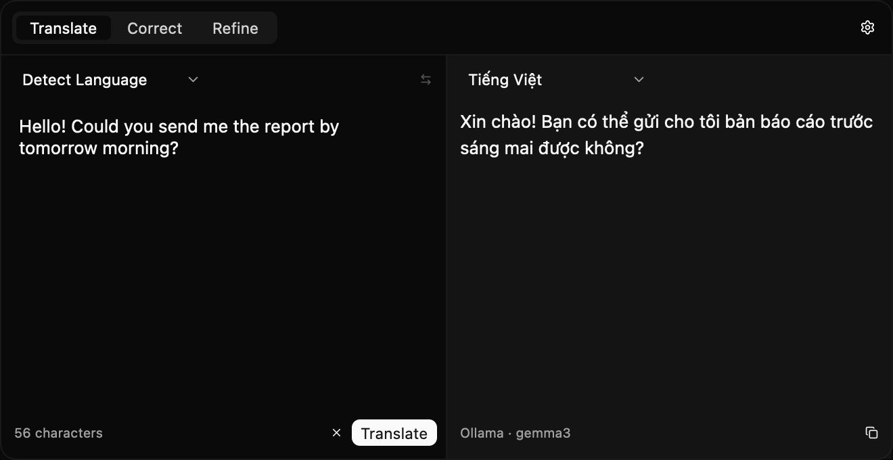
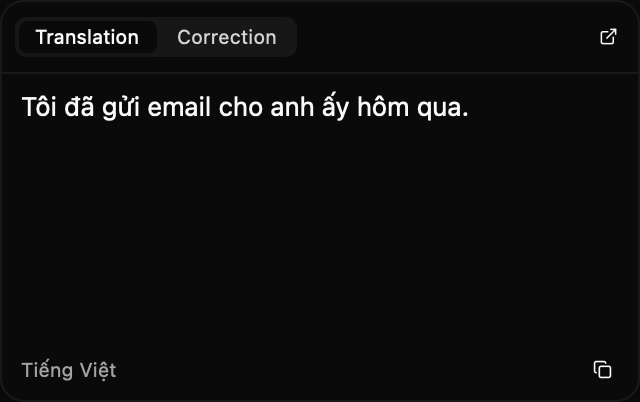
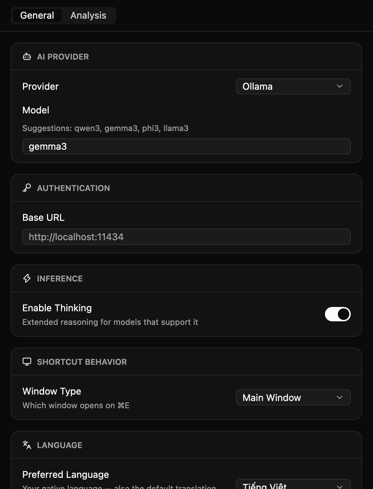

# Refiner

A small AI-powered app for translating, correcting and refining text. It
lives in the menu bar (system tray on Windows), and is a native rewrite of the
[Tauri version](https://github.com/leehuwuj/refiner) built with
[GPUI Kit](https://github.com/longbridge/gpui-kit) — no webview, no Node.

## Features

- **Translate / Correct / Refine** in the main window, side by side.
- **Global shortcut** (`⌘E` on macOS, `Ctrl+E` on Windows): reads the text
  selected in any app and processes it in the main window or in a compact
  popup next to the cursor (popup shows a translation and a correction).
- **Selection icon** (macOS and Windows, opt-in under Settings → General →
  Shortcut → Selection button): select text in a supported app and a small
  button appears beside it; click it for the compact popup. Windows uses UI
  Automation selection-change events and leaves the clipboard untouched.
- **Providers**: Ollama (local / offline), OpenAI and OpenAI-compatible
  servers, Gemini, Groq. Optional "thinking" switch for reasoning models.
- **Custom prompts** per mode, with `{original_lang}` and `{target_lang}`.
- **Language analysis**: optionally records your inputs and asks the model for
  an HTML proficiency report (CEFR estimate, recurring errors, study plan).
- Light / dark / system theme and three text sizes.

## Screenshots

| Main window | Popup | Settings |
| --- | --- | --- |
|  |  |  |

## Run

Requires Rust 1.92+. On macOS only the Command Line Tools are needed (shaders
compile at runtime).

```bash
cargo run --release
```

Build a `Refiner.app` bundle (menu-bar only, no Dock icon):

```bash
./script/bundle-macos.sh
```

### Windows

Install Rust 1.92+ with the MSVC toolchain and Visual Studio Build Tools
with **Desktop development with C++** and a Windows 10/11 SDK. Use the
toolchain matching your machine (`x86_64-pc-windows-msvc` for x64 or
`aarch64-pc-windows-msvc` for ARM64).

```powershell
cargo test --locked
cargo run --release --locked
```

The executable is `target\release\refiner.exe`. Release builds compile GPUI's
HLSL shaders with the Windows SDK's `fxc.exe`. If SDK discovery fails, set
`GPUI_FXC_PATH` to the full path of that executable before building.

Left-click the tray icon to reopen Refiner; right-click for Settings,
Analysis, or Quit. `Ctrl+E` reads the active application's selection through
Windows UI Automation. It never sends Ctrl+C or reads or changes the clipboard.
If the application does not expose its selected text through UI Automation,
no text is submitted. Capturing text from an elevated application requires
appropriate Windows privileges.
Enable **Selection button** in Settings to show an icon beside selections
exposed by UI Automation. The icon does not take focus from the source app;
clearing the selection or changing focus dismisses it.
The Windows icon appears only after mouse release or after releasing a
keyboard selection key (Shift+arrows/Home/End/Page Up/Page Down or Ctrl+A).
Starting another selection hides it; dragging does not create icon windows.
The icon sits just above the top-left corner of the first visible
selected line, using UI Automation's text bounds for mouse and keyboard
selections. If no visible bounds are available, the icon stays hidden.

The Windows CI workflow runs unit tests and produces a release x64 executable.

### macOS permissions

Refiner reads the selected text through the Accessibility API, so it (or your
terminal, when running from source) needs **System Settings → Privacy &
Security → Accessibility**; macOS asks on first launch. Apps that don't expose
their selection (some terminals, Electron and Java apps) fall back to sending
`⌘C` through System Events, which asks once to allow controlling System
Events. The selection icon never uses `⌘C`, so it only appears in apps that
expose their selection.

## Data

Settings, history and reports live in the same folder as the Tauri build, so
an upgrade keeps them. On first launch the old `store.bin` is imported.

| OS      | Folder                                                  |
| ------- | ------------------------------------------------------- |
| macOS   | `~/Library/Application Support/dev.leehuwuj.refiner`   |
| Windows | `%APPDATA%\dev.leehuwuj.refiner`                        |

Set `REFINER_DATA_DIR` to use another folder (useful for development).

## Development

```bash
cargo test                       # unit tests
REFINER_LIVE_URL=http://localhost:11434 REFINER_LIVE_MODEL=gemma3 \
  cargo test live -- --ignored   # one real request against Ollama
REFINER_SNAPSHOT=/tmp/shots cargo run --features snapshot
                                 # render every window to PNGs, then quit
```

| Module            | Role                                                     |
| ----------------- | -------------------------------------------------------- |
| `settings.rs`     | Settings model, JSON persistence, Tauri store import     |
| `llm.rs`          | Blocking provider clients (Ollama, OpenAI, Gemini, Groq) |
| `refine.rs`       | Prompts and the translate / correct / refine operations  |
| `history.rs`      | Optional request history                                 |
| `analysis.rs`     | Language analysis report                                 |
| `state.rs`        | GPUI models shared by the windows                        |
| `windows.rs`      | Opening, positioning and close-on-blur of windows        |
| `tray.rs`         | Menu-bar icon and menu                                   |
| `hotkey.rs`       | Global shortcut and selected-text capture                |
| `platform.rs`     | macOS / Windows specifics (⌘C, cursor, accessory app)    |
| `ax.rs`           | macOS Accessibility: read the selected text              |
| `selection_watch.rs` | Global mouse monitor behind the selection icon        |
| `ui/`             | Main window, popup and settings views                    |

## License

MIT
